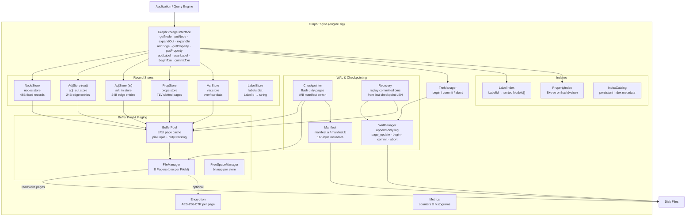
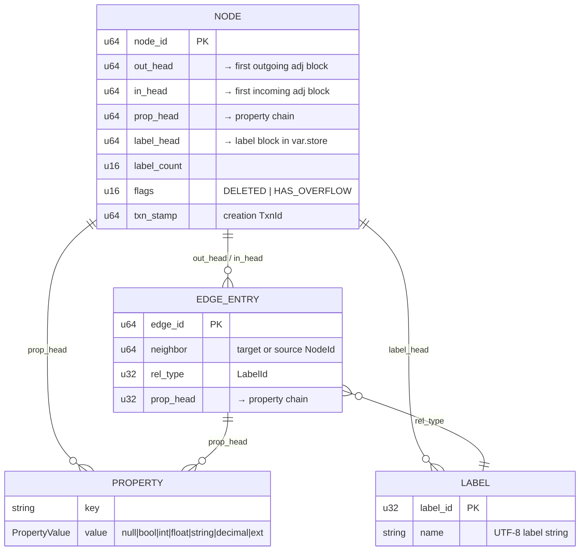
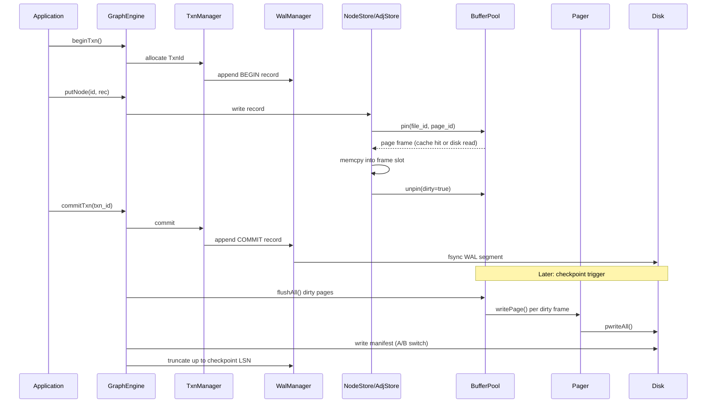
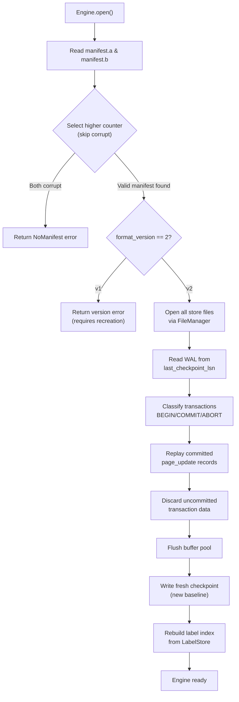
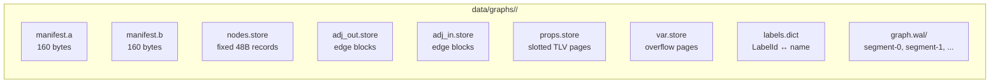

# graph-storage

[](LICENSE)
[](https://ziglang.org/)

A high-performance, disk-resident graph storage engine written in Zig. Designed
for single-graph OLTP workloads with crash-safe durability, incremental
checkpointing, and locality-friendly adjacency traversal.

## Architecture Overview



## Data Model

The engine stores a **labeled property graph** where nodes and edges carry
key-value properties and zero or more labels.



## Write Path



## Crash Recovery



## On-Disk Layout



### Page Format (all stores)

```
┌──────────────────────────────────────────┐
│  PageHeader (32 bytes)                   │
│  ┌─────────┬─────────┬──────┬──────────┐ │
│  │page_id  │  lsn    │crc32c│page_type │ │
│  │  (u64)  │ (u64)   │(u32) │  (u8)    │ │
│  ├─────────┴─────────┴──────┴──────────┤ │
│  │flags(u8)│item_count│free_start/end  │ │
│  │         │  (u16)   │   (u16/u16)    │ │
│  └─────────┴──────────┴───────────────┘ │
├──────────────────────────────────────────┤
│  Page Body (page_size - 32 bytes)        │
│  (store-specific layout)                 │
└──────────────────────────────────────────┘
```

## Features

- **Page-Based Storage**: 8KB pages with CRC32C integrity, LRU buffer pool
- **WAL Durability**: Write-ahead logging with real transaction boundaries (BEGIN/COMMIT/ABORT)
- **Crash Recovery**: Replay committed transactions from last checkpoint LSN
- **Incremental Checkpointing**: Flush only dirty pages, A/B manifest switching
- **Locality-Friendly Adjacency**: Edge blocks with 339 entries per page, overflow chaining
- **Typed Properties**: TLV encoding for null, bool, int, float, string, decimal, ext
- **Label Dictionary**: Bidirectional LabelId-to-string mapping, persisted to `labels.dict`
- **Secondary Indexes**: Label posting lists, optional B+tree property indexes
- **Optional Encryption**: AES-256-CTR per-page encryption with key zeroization
- **Authenticated Backup**: Self-contained archives with CRC32C + optional HMAC-SHA256
- **Free Space Reuse**: Bitmap-based page allocation with O(1) amortized alloc
- **Minimal Dependencies**: Only [wal](https://gitlab.com/devnw/zig/wal) and [uuid](https://gitlab.com/devnw/zig/uuid)
- **Cross-Platform**: Linux, macOS, Windows support

## Installation

### Using Zig Package Manager

Add to your `build.zig.zon`:

```zig
.dependencies = .{
    .graph_storage = .{
        .url = "https://gitlab.com/devnw/zig/graph_storage/-/archive/v0.1.0/graph_storage-v0.1.0.tar.gz",
        .hash = "...",
    },
},
```

Then in your `build.zig`:

```zig
const graph_storage = b.dependency("graph_storage", .{
    .target = target,
    .optimize = optimize,
});
exe.root_module.addImport("graph_storage", graph_storage.module("graph_storage"));
```

## Quick Start

```zig
const std = @import("std");
const gs = @import("graph_storage");

pub fn main() !void {
    var gpa = std.heap.GeneralPurposeAllocator(.{}){};
    defer _ = gpa.deinit();
    const allocator = gpa.allocator();

    const graph_uuid = [_]u8{0} ** 16; // use a real UUID in production
    const cfg = gs.GraphConfig{};

    // Create a new graph (or use GraphEngine.open() for an existing one)
    const engine = try gs.GraphEngine.create(allocator, "data", graph_uuid, cfg);
    defer engine.close() catch {};

    // Allocate a node and add a label
    const node_id = try engine.allocNode();
    const label_id = engine.labelDict().getOrAssign("Person");
    try engine.addLabel(node_id, label_id);

    // Set a property
    _ = try engine.putProperty(node_id, "name", .{ .string = "Alice" });

    // Add an edge
    const other = try engine.allocNode();
    const knows = engine.labelDict().getOrAssign("KNOWS");
    _ = try engine.addEdge(node_id, other, knows);

    // Traverse outgoing edges
    var iter = try engine.expandOut(node_id, null);
    defer iter.deinit();
    while (try iter.next()) |entry| {
        std.debug.print("edge {} -> neighbor {}\n", .{ entry.edge_id, entry.neighbor });
    }

    // Checkpoint to persist
    try engine.checkpoint();
}
```

## Configuration

```zig
const cfg = gs.GraphConfig{
    .page_size = 8192,                          // bytes per page
    .buffer_pool_pages = 1024,                  // frames in LRU cache
    .buffer_pool_auto_size = true,              // auto-size from manifest
    .wal_segment_size = 16 * 1024 * 1024,       // 16 MB WAL segments
    .checkpoint_byte_threshold = 16 * 1024 * 1024, // checkpoint after 16 MB WAL
    .checkpoint_time_threshold_ms = 60_000,     // checkpoint every 60s
    .encryption_key = null,                     // optional 32-byte AES key
};
```

## Requirements

- Zig 0.15.1 or later

## Building

```bash
# Build the library
make build

# Run tests
make test

# Quick development iteration
make dev

# Full CI pipeline
make ci
```

## Documentation

See the [docs](docs/) directory for detailed documentation:

- **[Architecture Guide](docs/architecture.md)** -- Module structure, data flow, concurrency
- **[Binary Format Specification](docs/format-spec.md)** -- On-disk page/record layouts
- **[Storage Requirements](docs/storage-requirements.md)** -- Functional requirements (FR-001 through FR-030+)
- **[Storage Research](docs/storage-research.md)** -- Design rationale, bottleneck analysis, prior-art review

## Contributing

See [CONTRIBUTING.md](CONTRIBUTING.md) for guidelines.

## Security

See [SECURITY.md](SECURITY.md) for security policy and vulnerability reporting.

## License

This project is licensed under the Apache License 2.0 - see the [LICENSE](LICENSE) file for details.
