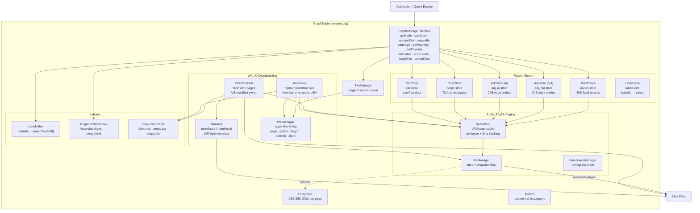
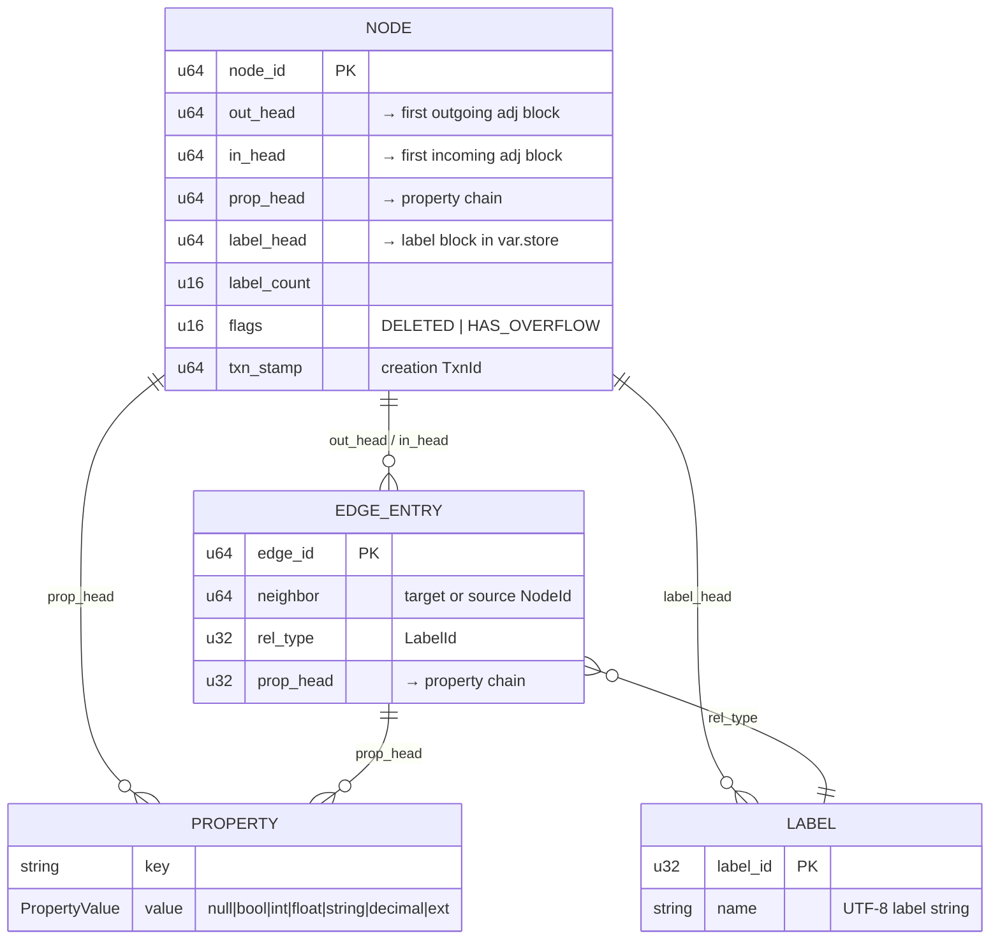
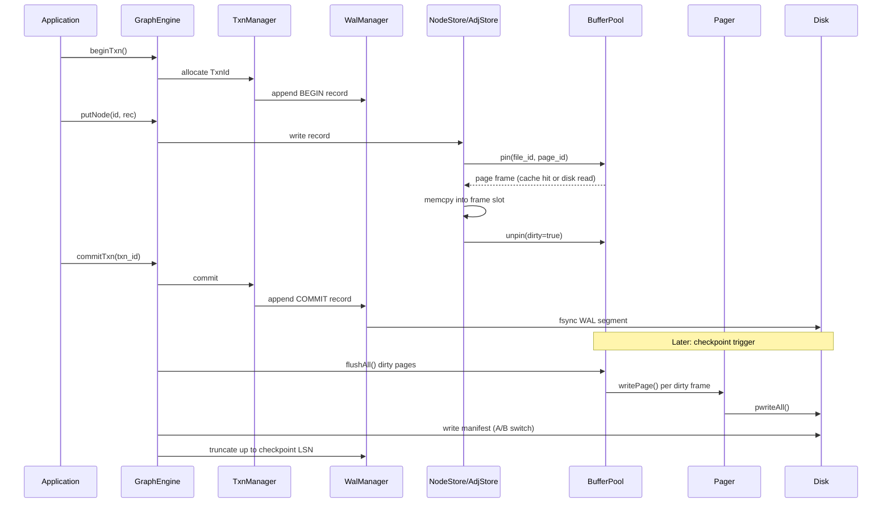
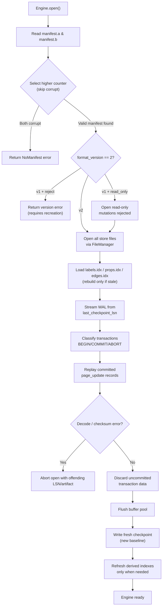
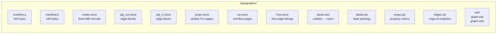

# graph-storage

[](LICENSE)
[](https://ziglang.org/)

A high-performance, disk-resident graph storage engine written in Zig. Designed
for single-graph OLTP workloads with crash-safe durability, incremental
checkpointing, and locality-friendly adjacency traversal.

## Architecture Overview



## Data Model

The engine stores a **labeled property graph** where nodes and edges carry
key-value properties and zero or more labels.



## Write Path



## Crash Recovery



## On-Disk Layout



### Page Format (all stores)

```
┌──────────────────────────────────────────┐
│  PageHeader (32 bytes)                   │
│  ┌─────────┬─────────┬──────┬──────────┐ │
│  │page_id  │  lsn    │crc32c│page_type │ │
│  │  (u64)  │ (u64)   │(u32) │  (u8)    │ │
│  ├─────────┴─────────┴──────┴──────────┤ │
│  │flags(u8)│item_count│free_start/end  │ │
│  │         │  (u16)   │   (u16/u16)    │ │
│  └─────────┴──────────┴───────────────┘ │
├──────────────────────────────────────────┤
│  Page Body (page_size - 32 bytes)        │
│  (store-specific layout)                 │
└──────────────────────────────────────────┘
```

## Features

- **Page-Based Storage**: Configurable page sizes with CRC32C integrity and an LRU buffer pool
- **WAL Durability**: Write-ahead logging with real transaction boundaries (BEGIN/COMMIT/ABORT)
- **Crash Recovery**: Stream committed WAL replay from the last checkpoint LSN
- **Incremental Checkpointing**: Flush only dirty pages, A/B manifest switching
- **Locality-Friendly Adjacency**: Edge blocks with 339 entries per page, overflow chaining
- **Typed Properties**: TLV encoding for null, bool, int, float, string, decimal, ext
- **Derived Snapshots**: Persisted `labels.idx`, `props.idx`, and `edges.idx` accelerate reopen paths
- **Optional Encryption**: AES-256-GCM per-page encryption with key zeroization
- **Authenticated Backup**: Self-contained archives with CRC32C + optional HMAC-SHA256
- **Free Space Reuse**: Bitmap-based page allocation with O(1) amortized alloc
- **Iterator Hot Paths**: `expandOutIter`, `expandInIter`, and `scanLabelIter` avoid result-sized allocations
- **Minimal Dependencies**: [wal](https://gitlab.com/devnw/zig/wal), [uuid](https://gitlab.com/devnw/zig/uuid), and [spice](https://gitlab.com/devnw/zig/spice)
- **Cross-Platform**: Linux, macOS, Windows support
- **ShardedStore Primitive** _(v0.2.0+)_: N-way sharded `std.AutoHashMap` wrapper published for consumers that build concurrent in-memory graph structures on top of the single-threaded engine — see [docs/sharded-store.md](docs/sharded-store.md)

## Installation

### Using Zig Package Manager

Add to your `build.zig.zon`:

```zig
.dependencies = .{
    .graph_storage = .{
        .url = "https://gitlab.com/devnw/zig/graph-storage/-/archive/v0.2.0/graph-storage-v0.2.0.tar.gz",
        .hash = "...",
    },
},
```

Then in your `build.zig`:

```zig
const graph_storage = b.dependency("graph_storage", .{
    .target = target,
    .optimize = optimize,
});
exe.root_module.addImport("graph_storage", graph_storage.module("graph_storage"));
```

## Quick Start

```zig
const std = @import("std");
const gs = @import("graph_storage");

pub fn main() !void {
    var gpa = std.heap.GeneralPurposeAllocator(.{}){};
    defer _ = gpa.deinit();
    const allocator = gpa.allocator();

    const graph_uuid = [_]u8{0} ** 16; // use a real UUID in production
    const cfg = gs.GraphConfig{};

    // Create a new graph (or use GraphEngine.open() for an existing one)
    const engine = try gs.GraphEngine.create(allocator, "data", graph_uuid, cfg);
    defer engine.close() catch {};

    const empty_node = gs.node.NodeRec{
        .out_head = 0,
        .in_head = 0,
        .prop_head = 0,
        .label_head = 0,
        .label_count = 0,
        .flags = 0,
        ._pad = .{ 0, 0, 0, 0 },
        .txn_stamp = 1,
    };

    const alice = try engine.allocNode();
    try engine.putNode(alice, empty_node);
    const bob = try engine.allocNode();
    try engine.putNode(bob, empty_node);

    try engine.addLabel(alice, 1);
    _ = try engine.addEdge(alice, bob, 10);

    var alice_rec = (try engine.getNode(alice)).?;
    alice_rec.prop_head = try engine.putProperty(alice_rec.prop_head, "name", .{ .string = "Alice" });
    try engine.putNode(alice, alice_rec);

    var edge_iter = try engine.expandOutIter(alice, null);
    defer edge_iter.deinit();
    while (try edge_iter.next()) |edge| {
        std.debug.print("edge {} -> neighbor {}\n", .{ edge.edge_id, edge.neighbor });
    }

    var label_iter = try engine.scanLabelIter(1);
    defer label_iter.deinit();
    while (try label_iter.next()) |node_id| {
        std.debug.print("label 1 contains node {}\n", .{node_id});
    }

    try engine.checkpoint();
}
```

See [examples/basic.zig](examples/basic.zig) for a larger end-to-end example that is built by `zig build`.

## Configuration

```zig
const cfg = gs.GraphConfig{
    .page_size = 4096,                      // bytes per page
    .buffer_pool_pages = 64,                // frames in LRU cache
    .buffer_pool_auto_size = true,          // auto-size from manifest on open
    .wal_segment_size = 16 * 1024 * 1024,   // 16 MB WAL segments
    .checkpoint_byte_threshold = 16 * 1024 * 1024, // checkpoint after 16 MB WAL
    .checkpoint_time_threshold_ms = 60_000, // or checkpoint every 60 seconds
    .encryption_key = null,                 // optional 32-byte AES-256-GCM key
};
```

## Requirements

- Zig 0.15.1 or later (`build.zig.zon` minimum); CI currently validates with Zig 0.15.2

## Building

```bash
# Build the library
make build

# Run tests
make test

# Quick development iteration
make dev

# Full CI pipeline
make ci
```

## Documentation

See the [docs](docs/) directory for detailed documentation:

- **[Architecture Guide](docs/architecture.md)** -- Module structure, data flow, concurrency
- **[Binary Format Specification](docs/format-spec.md)** -- On-disk page/record layouts
- **[Storage Requirements](docs/storage-requirements.md)** -- Functional requirements (FR-001 through FR-030+)
- **[Storage Research](docs/storage-research.md)** -- Design rationale, bottleneck analysis, prior-art review

## Contributing

See [CONTRIBUTING.md](CONTRIBUTING.md) for guidelines.

## Security

See [SECURITY.md](SECURITY.md) for security policy and vulnerability reporting.

## License

This project is licensed under the Apache License 2.0 - see the [LICENSE](LICENSE) file for details.
