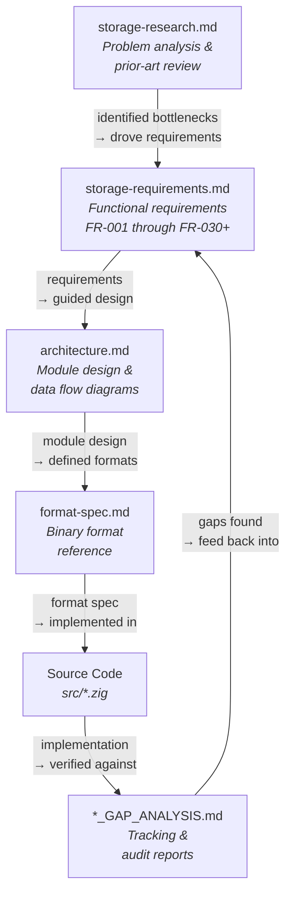

# graph-storage Documentation

## Overview

graph-storage is a disk-resident, page-based graph storage engine for
single-graph OLTP workloads. It provides crash-safe durability through
write-ahead logging, incremental checkpointing, and A/B manifest switching.

## Table of Contents

### Core Documentation

- **[Architecture Guide](architecture.md)** -- Module dependency graph, data
  flow diagrams (write/read/checkpoint paths), buffer pool design, adjacency
  storage, recovery process, concurrency model, and type reference.

- **[Binary Format Specification](format-spec.md)** -- Complete on-disk layouts
  for pages, node records, edge entries, property TLV encoding, manifest,
  backup archive, WAL records, registry, and index catalog.

### Design & Requirements

- **[Storage Requirements](storage-requirements.md)** -- Functional requirements
  (FR-001 through FR-030+) specifying per-graph isolation, buffer pool, WAL
  integration, incremental checkpointing, free-space management, indexing,
  migration tooling, and operational capabilities.

- **[Storage Research](storage-research.md)** -- Code-first architecture review
  of the legacy in-memory storage, bottleneck analysis, and comparative review
  of SQLite WAL, LMDB COW B+tree, RocksDB LSM, and graph-native approaches
  that informed the current page-based design.

### Analysis Reports

- **[Gap Analysis](GAP_ANALYSIS.md)** -- Requirements-to-implementation gap
  tracking.

- **[Quality Gap Analysis](QUALITY_GAP_ANALYSIS.md)** -- Code quality findings.

- **[Performance Gap Analysis](PERF_GAP_ANALYSIS.md)** -- Performance
  profiling and optimization tracking.

- **[Security Gap Analysis](SECURITY_GAP_ANALYSIS.md)** -- Security review
  findings.

- **[Audit Report](AUDIT_REPORT.md)** -- Comprehensive audit summary.

## Quick Links

- [Installation](../README.md#installation)
- [Quick Start](../README.md#quick-start)
- [Configuration](../README.md#configuration)
- [Contributing](../CONTRIBUTING.md)
- [Security](../SECURITY.md)
- [Changelog](../CHANGELOG.md)

## How the Documents Relate

