# Architecture Guide

This document describes the internal architecture of the graph-storage engine,
how its modules connect, how data flows from API calls to disk, and how the
design relates to the requirements in
[storage-requirements.md](storage-requirements.md) and the research in
[storage-research.md](storage-research.md).

---

## Module Dependency Graph

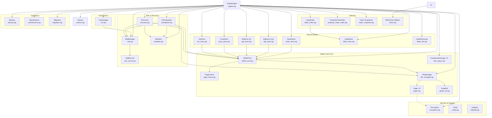

---

## Data Flow

### Write Path (mutation to durable commit)

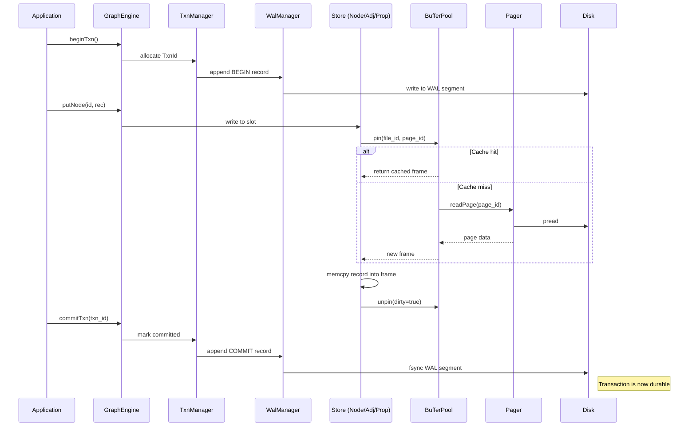

### Checkpoint Path (dirty pages to disk)

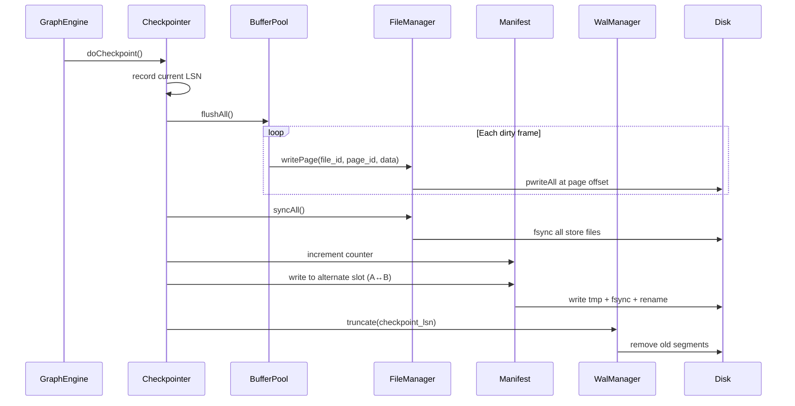

### Read Path (query to page fetch)

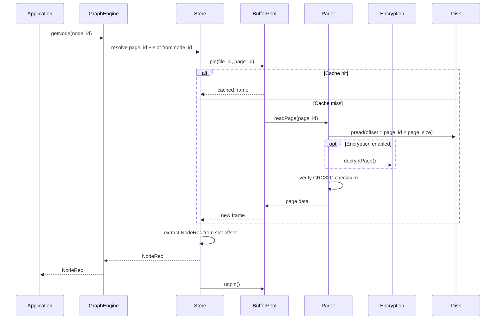

---

## Recovery Process

Recovery restores the engine to a consistent state after a crash by replaying
committed WAL records from the last checkpoint.

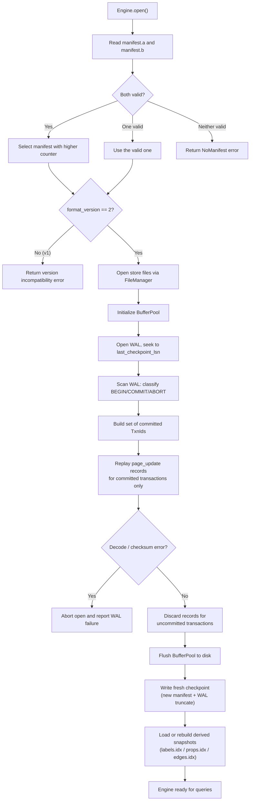

This design satisfies **FR-012** (real transaction IDs with BEGIN/COMMIT/ABORT)
and **FR-013** (incremental checkpointing with bounded recovery).

---

## Buffer Pool

The buffer pool is the central caching layer between stores and disk I/O.

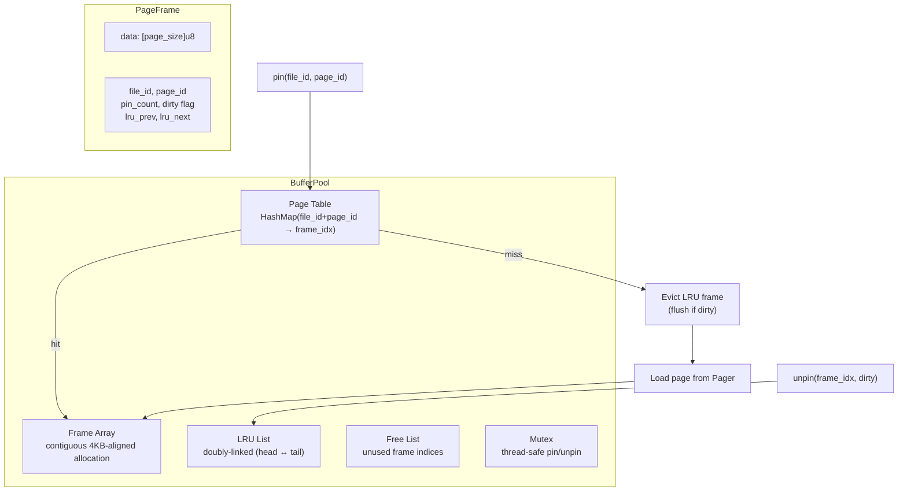

**Key properties:**

- Pin/unpin reference counting prevents eviction of in-use pages
- Dirty flag tracks frames needing write-back at checkpoint
- LRU eviction ensures the working set stays in memory
- Auto-sizing: buffer pool can scale from manifest page counts (1024--65536 frames)

---

## Adjacency Storage

Edges are stored in **adjacency blocks** -- one chain for outgoing edges, one
for incoming edges. Each node's `out_head` / `in_head` points to its first
block.

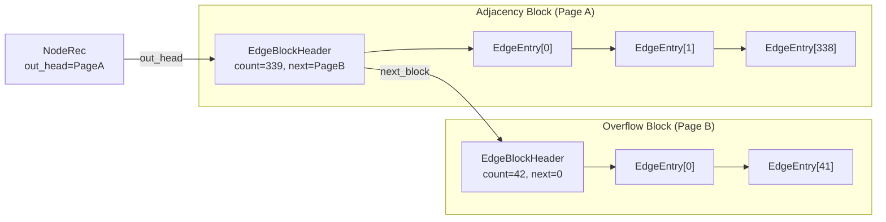

**Capacity:** `(page_size - 32 - 16) / 24` entries per block.
At 8KB pages: **339 entries per block**.

New edges are **head-inserted** for O(1) addition. Relationship-type filtering
reads `rel_type` per entry without materializing unrelated edges, satisfying
**FR-008**.

---

## Property Storage

Properties use a **slotted-page** layout with TLV (tag-length-value) encoding.

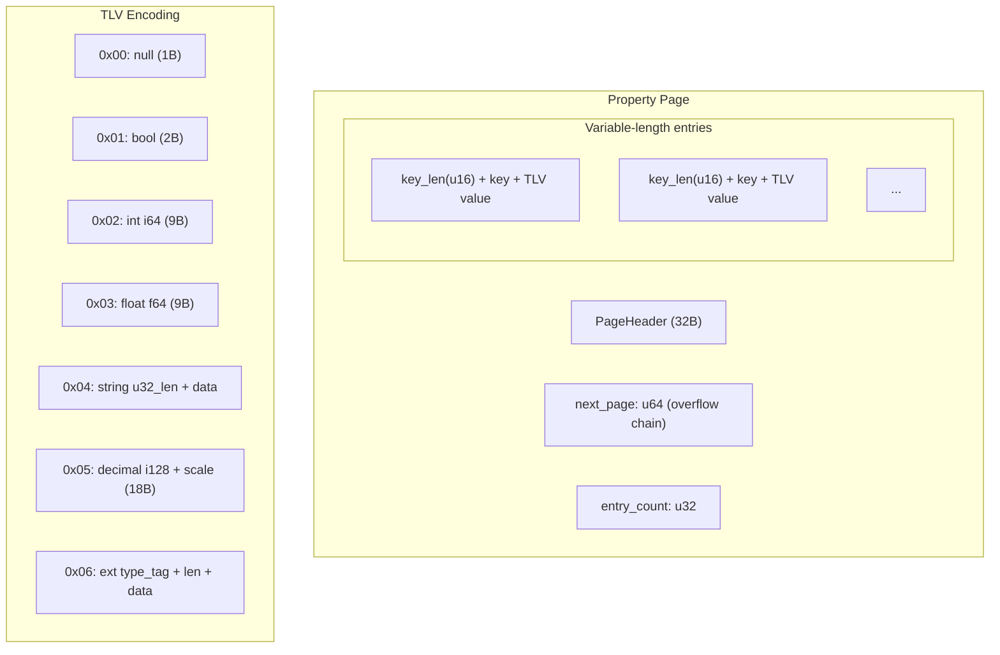

Large values that don't fit in a property page spill to **VarStore** overflow
pages, which chain via `next_page` pointers. This satisfies **FR-009**.

---

## Transaction Lifecycle

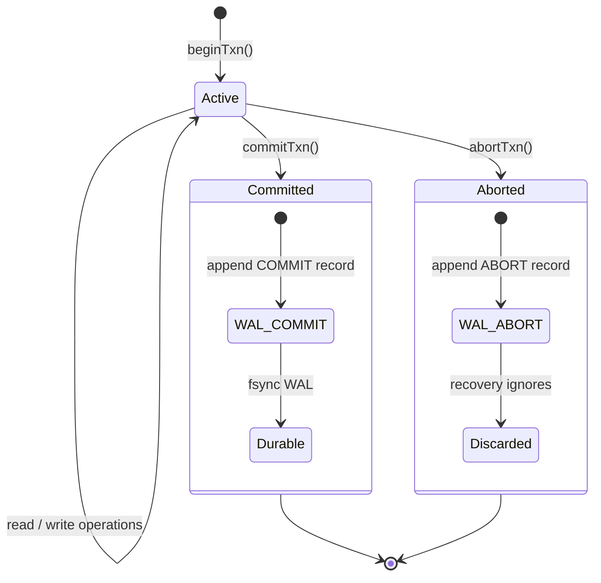

---

## Checkpoint & Manifest A/B Switching

The manifest uses a double-copy strategy for crash-safe metadata updates.

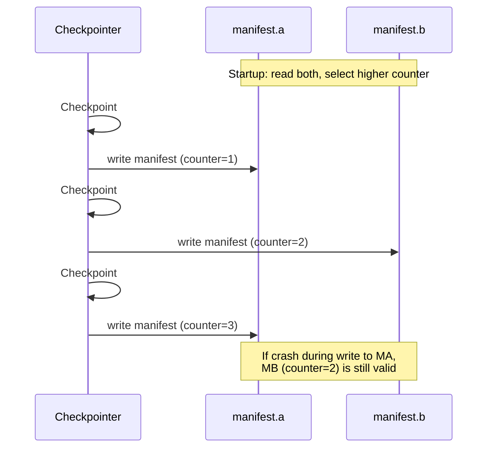

Each manifest write is atomic: write to `.tmp`, `fsync`, then `rename`.
This satisfies **FR-005**.

---

## Encryption Flow

When an encryption key is configured, page I/O is transparently encrypted.

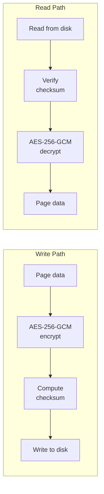

- Per-page encryption (not whole-file)
- The side files holding schema names or indexed values (`labels.dict`,
  `props.idx`, `ordered_propidx.snap`, `props.catalog`, `propidx_*.btree`)
  are sealed whole with a key derived from the same key (SONNY-6590,
  `docs/format-spec.md` §1.6); id-only snapshots stay plaintext
- Key provided via `GraphConfig.encryption_key`
- `GraphConfig.zeroKey()` securely clears key material
- Backup format v2 adds HMAC-SHA256 authentication

---

## Backup Format

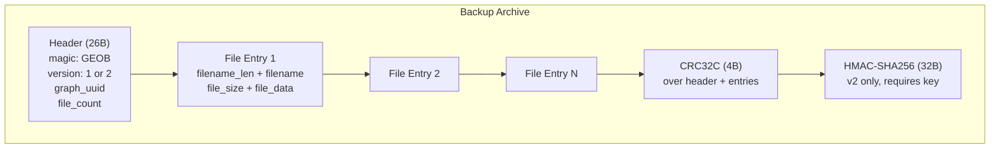

**Included files:** manifest.a, manifest.b, nodes.store, adj_out.store,
adj_in.store, props.store, var.store, free.store, labels.dict, and
optionally indexes/catalog.bin.

---

## Indexing

### Label Index

In-memory posting lists mapping `LabelId` to sorted `[]NodeId`. Rebuilt from
the node store on startup. Snapshots are persisted to `labels.idx` at
checkpoint boundaries for faster warm restarts. Used by `scanLabel()` for
label-based node lookups.

### PropertyChainIndex

In-memory hash index that maps `(key_hash, value_hash)` pairs to sorted
`[]NodeId` lists. Built by scanning the property store on startup. Used for
fast exact-match property lookups without requiring a B+tree on disk.
Snapshots are persisted to `props.idx` at checkpoint boundaries for faster
warm restarts.

### Experimental Secondary-Index Modules

`property_index.zig`, `index_catalog.zig`, and `btree.zig` remain available as
standalone building blocks, but they are not part of the current
`GraphEngine.open()` / query / checkpoint hot path. The live runtime topology
uses `LabelIndex`, `PropertyChainIndex`, and persisted snapshot files instead.

---

## Relationship to Design Documents

| Module | Requirements | Research Reference |
|--------|-------------|-------------------|
| Per-graph directory layout | FR-001 (graph isolation) | storage-research.md §"Graph isolation" |
| Manifest A/B switching | FR-005 (versioned manifests) | storage-research.md §"WAL/checkpointing" |
| BufferPool + Pager | FR-006 (buffer pool, explicit I/O) | storage-research.md §"SQLite WAL + pager model" |
| NodeStore (fixed records) | FR-007 (fixed-record node store) | storage-research.md §"Read amplification" |
| AdjStore (edge blocks) | FR-008 (locality-friendly adjacency) | storage-research.md §"Hot query path" |
| PropStore (slotted pages) | FR-009 (slotted property store) | storage-research.md §"Data model on disk" |
| FreeSpaceManager | FR-010 (free-space management) | storage-research.md §"Write amplification" |
| WalManager (segmented WAL) | FR-011 (segmented WAL per graph) | storage-research.md §"WAL integration risks" |
| TxnManager (real txn IDs) | FR-012 (transaction boundaries) | storage-research.md §"WAL integration risks" |
| Checkpointer (incremental) | FR-013 (incremental checkpoint) | storage-research.md §"Checkpoint cost" |
| LabelIndex + PropertyChainIndex + snapshot persistence | FR-018+ (index support) | storage-research.md §"LMDB COW B+tree" |

---

## Concurrency Model

The current engine uses a **single-writer** model:

- **BufferPool mutex** guards frame table and LRU list (thread-safe pin/unpin)
- **TxnManager mutex** guards transaction ID allocation
- **WAL** provides serialization point for transaction ordering
- Readers can run concurrently via buffer pool caching
- Application is responsible for write serialization

Multi-writer support and full MVCC are reserved for future work (see
`txn_stamp` field in NodeRec).

---

## Type Reference

| Type | Zig Type | Size | Description |
|------|----------|------|-------------|
| `NodeId` | u64 | 8B | Node identifier |
| `EdgeId` | u64 | 8B | Edge identifier |
| `PageId` | u64 | 8B | Page identifier |
| `SlotId` | u16 | 2B | Slot within a page |
| `LabelId` | u32 | 4B | Label / relationship type |
| `TxnId` | u64 | 8B | Transaction identifier |
| `Lsn` | u64 | 8B | Log Sequence Number |
| `GraphUuid` | [16]u8 | 16B | 128-bit graph UUID |
| `NodeRec` | extern struct | 48B | Node record (v2) |
| `EdgeEntry` | extern struct | 24B | Edge adjacency entry |
| `EdgeBlockHeader` | extern struct | 16B | Adjacency block header |
| `PageHeader` | extern struct | 32B | Page header |
| `PropertyValue` | tagged union | varies | null/bool/int/float/string/decimal/ext |
